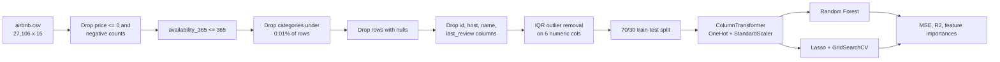
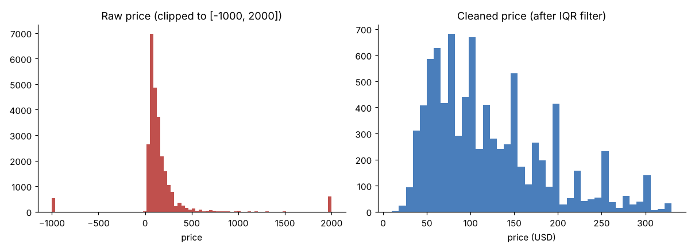
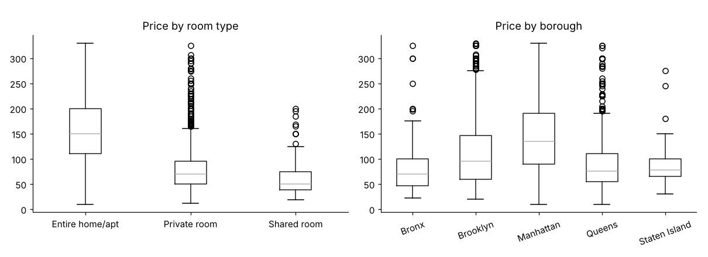
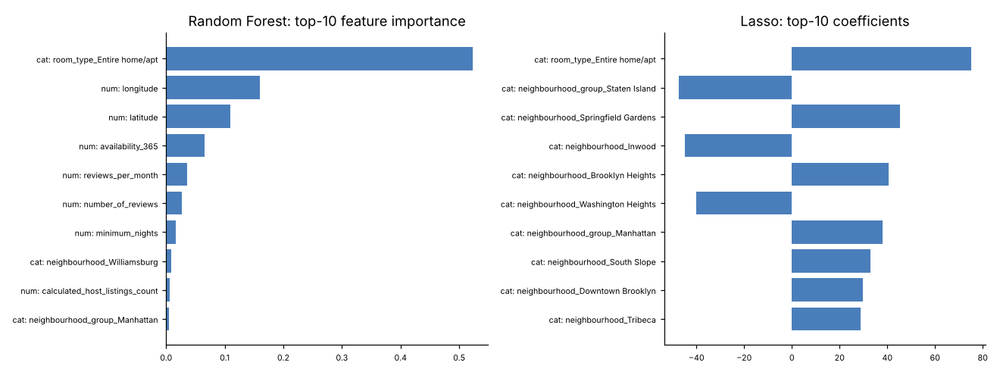
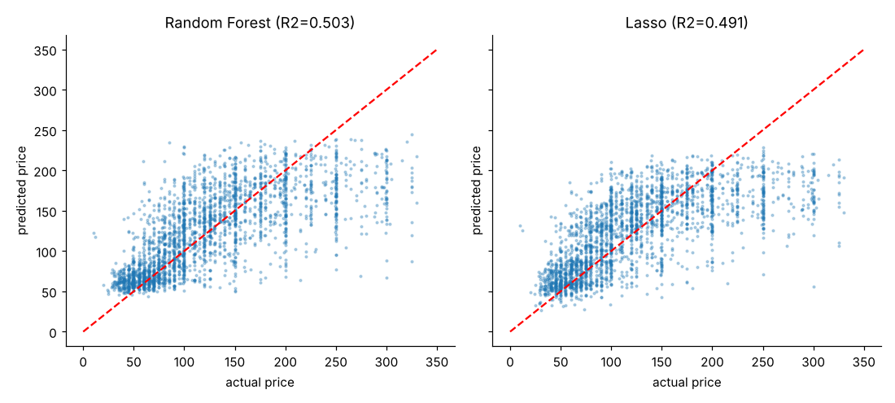

# NYC Airbnb Listing Price Prediction

Solo project from the Data Science course (2190513). Exploratory data analysis, data cleaning and regression modelling on a New York City Airbnb listings dataset, comparing a Random Forest against a tuned Lasso regression for predicting nightly price.

## Overview

The notebook loads a raw listings table (27,106 rows, 16 columns), finds and removes corrupt values (negative prices, negative counts, impossible availability, junk category labels, missing rows, outliers), encodes and scales the features with a scikit-learn pipeline, and fits two regressors to predict `price`. The Random Forest is the better model (R2 0.503 vs 0.491 for Lasso on the held-out test set). A short PDF report (`Report.pdf`) accompanies the notebook.

## Features

- Data-quality audit: missing values per column, negative or zero values in numeric columns, and junk categorical labels.
- Cleaning pipeline: invalid-value removal, rare-category filtering, null dropping, IQR outlier removal.
- Preprocessing with `ColumnTransformer` (one-hot encoding for categorical columns, standard scaling for numeric columns).
- Two models: Random Forest Regressor (fixed hyperparameters) and Lasso (5-fold `GridSearchCV` over 20 alpha values).
- Interpretation: Random Forest feature importances and Lasso coefficients.

## Tech stack

Python 3.13 (version recorded in the notebook metadata), Jupyter Notebook, pandas, NumPy, scikit-learn. The figures in this README were generated with matplotlib (not used in the notebook itself).

## Pipeline



## How it works

1. **Audit.** `df.info()`, `describe()` and null counts show many missing values and impossible numbers: `price` ranges from -44,039.91 to 44,388.41, `minimum_nights` has a minimum of -3,995.97, and categorical columns contain junk labels of the form `🦄_EXOTIC_<n>` (403 raw rows contain such a label, found by a check I ran on the CSV; the notebook finds them via `value_counts`).
2. **Cleaning** (row counts verified by re-running the logic):

| Step | Rows remaining |
|---|---|
| Raw data | 27,106 |
| Remove `price <= 0` and negative counts | 24,003 |
| Keep `availability_365 <= 365` | 23,047 |
| Drop categories rarer than 0.01% of rows (`neighbourhood_group`, `room_type`, `neighbourhood`) | 22,837 |
| Drop any row with a null | 14,580 |
| IQR (1.5x) outlier removal on price, minimum_nights, number_of_reviews, reviews_per_month, calculated_host_listings_count, availability_365 | 8,742 |

3. **Features.** `id`, `host_id`, `name`, `host_name`, `last_review` are dropped. Remaining features: neighbourhood_group, neighbourhood, room_type, latitude, longitude, minimum_nights, number_of_reviews, reviews_per_month, calculated_host_listings_count, availability_365 (10 features, 189 columns after encoding). No new features are engineered.
4. **Split.** 70/30 train/test (6,119 / 2,623 rows), `random_state=67381600`.
5. **Models.** Random Forest: `n_estimators=200, max_depth=13, min_samples_split=25`. Lasso: best `alpha` = 0.0336 from `np.logspace(-4, 0, 20)`, 5-fold CV scored on R2.

## Results

Cleaned data: 8,742 rows, price mean 120.63, median 100, min 10, max 330. Median price by room type: Entire home/apt 150, Private room 70, Shared room 50. Median by borough: Manhattan 135, Brooklyn 95, Staten Island 77.5, Queens 76, Bronx 70.

| Model | Test MSE | Test RMSE | Test MAE | Test R2 |
|---|---|---|---|---|
| Baseline (predict train mean) | 4462.17 | 66.80 | 53.37 | -0.003 |
| Lasso (alpha 0.0336, GridSearchCV) | 2261.61 | 47.56 | 35.05 | 0.4914 |
| **Random Forest** | **2210.20** | **47.01** | **33.94** | **0.5030** |

MSE and R2 for both models are identical to the notebook's saved outputs. The baseline row, RMSE and MAE are extra numbers I computed outside the notebook. Lasso 5-fold CV R2 on the training set was 0.5237; 70 of 189 coefficients were non-zero.

Top Random Forest features: room type Entire home/apt (importance 0.523), longitude (0.159), latitude (0.110), availability_365 (0.066), reviews_per_month (0.035).
Top Lasso coefficients: Entire home/apt (+75.16), Staten Island (-47.45), Springfield Gardens (+45.20), Inwood (-44.84), Brooklyn Heights (+40.61).








### Insights

- Room type is by far the strongest driver of price in the Random Forest.
- Location (latitude and longitude together about 0.27 importance) matters more than review activity.
- The report argues that Lasso trails because price is not linear in these features and the data lacks beds, bathrooms and size; this is the author's interpretation, not tested here.
- The report notes the Random Forest won even though only Lasso was tuned with GridSearchCV.
- Caveat: cleaning removes about 68% of raw rows (27,106 to 8,742), mostly by dropping rows with any null and by IQR trimming, so results apply to mid-priced listings (10 to 330) with complete data.
- Caveat: the Lasso coefficients for neighbourhood dummies are partly driven by rare neighbourhoods.

## How to run

```bash
pip install pandas numpy scikit-learn jupyter
cd "Data Sci (Airbnb data)"
jupyter notebook code.ipynb   # run all cells; expects airbnb.csv in the same folder
```

Re-running reproduces the notebook's saved MSE and R2 exactly (verified with scikit-learn 1.9.1, pandas 3.0.5). The figures in `docs/images/` were produced by a separate script following the same cleaning steps (not committed).

## Repository structure

```
Data Sci (Airbnb data)/
  airbnb.csv     raw dataset (27,106 rows, 16 columns; source/licence: TODO: confirm)
  code.ipynb     EDA, cleaning, modelling (about 157 lines of code, 17 code cells)
  Report.pdf     author's written report
docs/images/     figures used in this README
```

## Project Facts (for resume)

- **Course:** Data Science course (2190513)
- **Solo:** yes
- **Contributions:** the whole project (solo)
- **Languages / libraries:** Python 3.13; pandas, NumPy, scikit-learn (RandomForestRegressor, Lasso, GridSearchCV, ColumnTransformer, OneHotEncoder, StandardScaler, train_test_split); Jupyter.
- **Size:** 1 notebook with about 157 lines of code, 1 CSV (27,106 rows x 16 columns), 1 PDF report.
- **Algorithms:** Random Forest regression, Lasso (L1) regression with grid-searched alpha and 5-fold CV, IQR outlier removal, one-hot encoding, standardisation.
- **Measurable numbers (verified by re-run):** 27,106 raw rows to 8,742 cleaned rows; 189 encoded features; test R2 0.5030 (Random Forest) vs 0.4914 (Lasso); test MSE 2210.20 vs 2261.61; RMSE about 47 USD; MAE 33.94 vs 35.05; mean-price baseline R2 -0.003.
- **Hard problems and solutions:** corrupted data (negative prices and counts, availability above 365, junk `EXOTIC` category labels, about 2% nulls in most columns and about 22% in last_review/reviews_per_month) handled by rule-based filtering, rare-category thresholding and IQR trimming; model comparison on a leakage-safe pipeline (encoder and scaler fit on training data only).
- **Outcome:** Random Forest selected as best model; findings written up in Report.pdf. Grade or course result: TODO: confirm.
- **Data note:** dataset appears to be a real NYC Airbnb extract with artificially injected noise (negative values, junk labels, nulls); origin: TODO: confirm.
