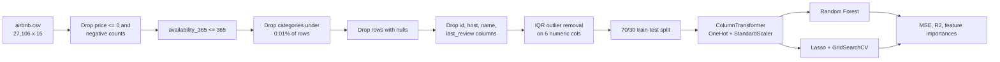
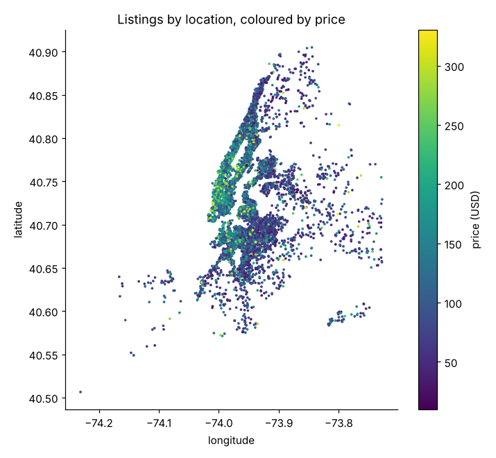
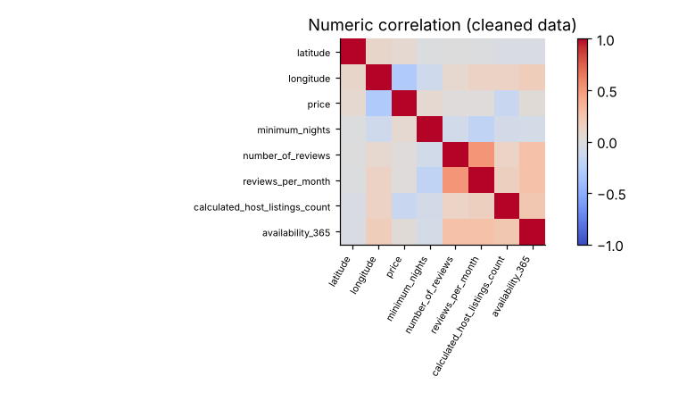

# NYC Airbnb Listing Price Prediction

My solo project for the Data Science course (2190513). I took a messy New York City Airbnb listings dataset, explored it, cleaned it up, and tried to predict the nightly price with two models: a Random Forest and a tuned Lasso regression.

## Overview

The raw table has 27,106 rows and 16 columns, and a lot of it is broken: negative prices, negative counts, availability over 365 days, junk category labels, missing values and big outliers. The notebook finds and removes all of that, encodes and scales the features with a scikit-learn pipeline, and then fits both models to predict `price`.

The Random Forest came out slightly ahead (R2 0.503 vs 0.491 for Lasso on the test set). There's also a short written report in `Report.pdf`.

## What's in the notebook

- A data-quality check: missing values per column, negative or zero values in numeric columns, and junk categorical labels.
- Cleaning: removing invalid values, filtering out rare categories, dropping nulls, and IQR outlier removal.
- Preprocessing with `ColumnTransformer` (one-hot encoding for categories, standard scaling for numbers).
- Two models: a Random Forest Regressor with fixed hyperparameters, and Lasso tuned with 5-fold `GridSearchCV` over 20 alpha values.
- A look at what the models learned: Random Forest feature importances and Lasso coefficients.

## Tech stack

Python 3.13, Jupyter Notebook, pandas, NumPy and scikit-learn. The charts in this README were made with matplotlib separately (the notebook itself doesn't use it).

## Pipeline



## How it works

1. **Looking at the data.** `df.info()`, `describe()` and null counts show plenty of missing values and numbers that make no sense. `price` goes from -44,039.91 all the way to 44,388.41, `minimum_nights` has a minimum of -3,995.97, and some categorical columns contain junk labels like `🦄_EXOTIC_<n>` (403 rows have one).
2. **Cleaning.** Here's how many rows survive each step:

| Step | Rows remaining |
|---|---|
| Raw data | 27,106 |
| Remove `price <= 0` and negative counts | 24,003 |
| Keep `availability_365 <= 365` | 23,047 |
| Drop categories rarer than 0.01% of rows (`neighbourhood_group`, `room_type`, `neighbourhood`) | 22,837 |
| Drop any row with a null | 14,580 |
| IQR (1.5x) outlier removal on price, minimum_nights, number_of_reviews, reviews_per_month, calculated_host_listings_count, availability_365 | 8,742 |

3. **Features.** I dropped `id`, `host_id`, `name`, `host_name` and `last_review`. That leaves 10 features: neighbourhood_group, neighbourhood, room_type, latitude, longitude, minimum_nights, number_of_reviews, reviews_per_month, calculated_host_listings_count and availability_365. After one-hot encoding that's 189 columns. I didn't engineer any new features.
4. **Split.** 70/30 train/test (6,119 / 2,623 rows), `random_state=67381600`.
5. **Models.** Random Forest uses `n_estimators=200, max_depth=13, min_samples_split=25`. For Lasso the best `alpha` was 0.0336, picked from `np.logspace(-4, 0, 20)` with 5-fold CV on R2.

## Results

After cleaning there are 8,742 listings with a mean price of 120.63 and a median of 100 (min 10, max 330). Median price by room type: entire home/apt 150, private room 70, shared room 50. By borough: Manhattan 135, Brooklyn 95, Staten Island 77.5, Queens 76, Bronx 70.

| Model | Test MSE | Test RMSE | Test MAE | Test R2 |
|---|---|---|---|---|
| Baseline (predict train mean) | 4462.17 | 66.80 | 53.37 | -0.003 |
| Lasso (alpha 0.0336, GridSearchCV) | 2261.61 | 47.56 | 35.05 | 0.4914 |
| **Random Forest** | **2210.20** | **47.01** | **33.94** | **0.5030** |

The MSE and R2 numbers come straight from the notebook. I added the baseline row, RMSE and MAE afterwards for comparison. On the training set, Lasso's 5-fold CV R2 was 0.5237, and 70 of its 189 coefficients ended up non-zero.

Top Random Forest features: room type entire home/apt (0.523), longitude (0.159), latitude (0.110), availability_365 (0.066), reviews_per_month (0.035).

Top Lasso coefficients: entire home/apt (+75.16), Staten Island (-47.45), Springfield Gardens (+45.20), Inwood (-44.84), Brooklyn Heights (+40.61).






### What I took away from it

- Room type matters far more than anything else for price.
- Location (latitude and longitude together are about 0.27 importance) matters more than how many reviews a place has.
- My guess for why Lasso is behind: price isn't linear in these features, and the data has no beds, bathrooms or size information. I didn't test this.
- The Random Forest still won even though only Lasso got tuned with GridSearchCV.
- Worth keeping in mind: cleaning throws away about 68% of the raw rows (27,106 down to 8,742), mostly from dropping nulls and IQR trimming. So the results really describe mid-priced listings (10 to 330) with complete data.
- Some of the Lasso neighbourhood coefficients are pushed around by neighbourhoods with very few listings.

## How to run

```bash
pip install pandas numpy scikit-learn jupyter
cd "Data Sci (Airbnb data)"
jupyter notebook code.ipynb   # run all cells; expects airbnb.csv in the same folder
```

Running it again gives the same MSE and R2 as the saved outputs (tested with scikit-learn 1.9.1 and pandas 3.0.5). The charts in `docs/images/` came from a separate script that follows the same cleaning steps; that script isn't in the repo.

## Repository structure

```
Data Sci (Airbnb data)/
  airbnb.csv     raw dataset (27,106 rows, 16 columns)
  code.ipynb     EDA, cleaning and modelling
  Report.pdf     written report
docs/images/     charts used in this README
```

## A note on the data

The dataset looks like a real NYC Airbnb extract with noise added on purpose (negative values, junk labels, nulls), which is what made the cleaning part interesting.
